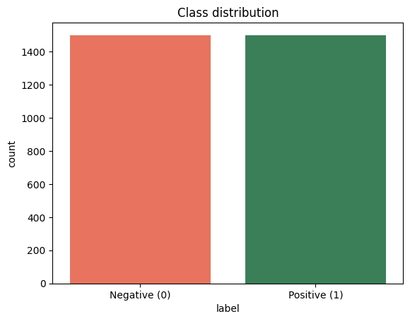
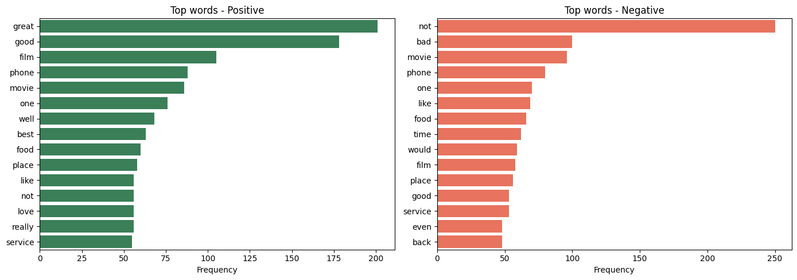
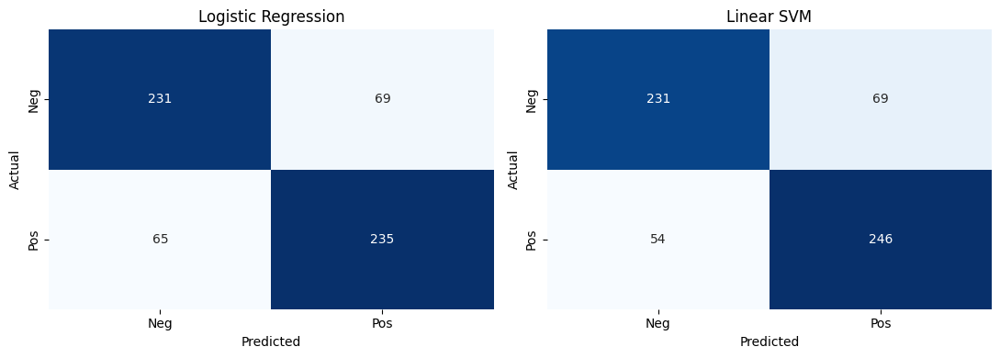

# Lab 01: Machine Learning – Sentiment Analysis with Traditional ML

**Module:** PUSL 3205 – Large Language Models and Generative AI
**Notebook:** [`notebook/Lab_Sheet_1.ipynb`](notebook/Lab_Sheet_1.ipynb)

## Laboratory Session
Lab 01 – Sentiment Analysis Using Traditional Machine Learning

## Objective
Build a sentiment classifier using a traditional machine learning pipeline (Bag-of-Words + linear models) and evaluate it. This gives a baseline for understanding why modern LLMs, which model context and word order, are needed for harder language tasks.

## Tasks and Implementation

**Dataset:** [UCI Sentiment Labelled Sentences](https://archive.ics.uci.edu/dataset/331/sentiment+labelled+sentences): 3,000 sentences (Amazon, IMDB, Yelp), labelled 1 = positive and 0 = negative, 1,500 of each.

| # | Task | Details |
|---|------|---------|
| 1 | Load and combine data | Read the three tab-separated files and concatenated them into one DataFrame (3,000 × 3). No missing values. |
| 2 | Text preprocessing | `clean_text()` lowercases, removes punctuation/numbers/special characters, and collapses whitespace. |
| 3 | Remove empty rows | Two sentences (`"10/10"`) became empty after cleaning and were dropped → 2,998 rows. |
| 4 | Exploratory analysis | Viewed sample sentences, class balance, and the most frequent words per class (stop words removed, but **negations kept**). |
| 5 | Train/test split | Stratified 80/20 split (`random_state=42`): 2,398 train / 600 test, 50/50 class ratio in both. |
| 6 | Feature extraction | `CountVectorizer` (Bag-of-Words), vocabulary fitted on training data only: 4,483 features, 99.76% sparse. |
| 7 | Model training | `LogisticRegression` and `LinearSVC`. |
| 8 | Evaluation | Accuracy, precision, recall, F1, classification report, confusion matrices, error analysis. |
| 9 | Prediction on new text | Tested both models on new, personal and deliberately tricky sentences. |

Key code (preprocessing and training):

```python
def clean_text(text):
    text = str(text).lower()
    text = re.sub(r"[^a-z\s]", " ", text)
    text = re.sub(r"\s+", " ", text).strip()
    return text

X_train, X_test, y_train, y_test = train_test_split(
    X, y, test_size=0.2, random_state=42, stratify=y)

bow = CountVectorizer()
X_train_bow = bow.fit_transform(X_train)   # fit on training data only
X_test_bow  = bow.transform(X_test)

log_reg = LogisticRegression(max_iter=1000, random_state=42).fit(X_train_bow, y_train)
svm     = LinearSVC(random_state=42).fit(X_train_bow, y_train)
```

To reproduce: `pip install pandas numpy nltk scikit-learn matplotlib seaborn`, then run all cells in the notebook (the dataset downloads automatically).

## Results and Evidence

### Class distribution


### Most frequent words by class


### Model performance (600 test sentences)

| Model | Accuracy | Precision | Recall | F1 |
|-------|---------:|----------:|-------:|---:|
| Logistic Regression | 0.7767 | 0.7730 | 0.7833 | 0.7781 |
| Linear SVM | **0.7950** | 0.7810 | 0.8200 | **0.8000** |

### Confusion matrices


### Words the Logistic Regression model weighted most
- **Positive:** great, love, excellent, best, good, nice, awesome, loved, delicious, amazing
- **Negative:** bad, poor, worst, not, terrible, awful, wasn, disappointment, didn, stupid

### Predictions on new sentences

| Sentence | LogReg | SVM |
|----------|:------:|:---:|
| "I absolutely loved this movie, the acting was brilliant!" | Positive | Positive |
| "The food was cold and the service was terrible." | Negative | Negative |
| "This phone has an amazing battery life." | Positive | Positive |
| "I would not recommend this product to anyone." | Negative | Negative |
| "It was okay, nothing special." | Negative | Negative |
| "The room wasn't clean at all." | Negative | Negative |
| "The movie was not bad at all." *(negation)* | Negative ❌ | Negative ❌ |
| "Oh great, another broken phone." *(sarcasm)* | Positive ❌ | Positive ❌ |
| "The food was good but the service was awful." *(mixed)* | Negative | Negative |

## Observations
- The **Linear SVM slightly outperformed Logistic Regression** (about 2 points of accuracy), mainly through higher recall on the positive class. Logistic Regression misclassified 134 of 600 test sentences.
- The learned weights were sensible: clear sentiment words dominated. **"not"** was far more frequent in negative reviews, so I kept negations out of the stop-word list.
- **Preprocessing issue:** removing punctuation split contractions, so "didn't" became "didn" + "t". The model then learned fragments like **"didn"** and **"wasn"** as negative signals.
- **Failure cases:** Bag-of-Words ignores word order, so it failed on negation ("not bad at all" → Negative), sarcasm ("Oh great, another broken phone" → Positive), and cannot represent neutral text, since the classifier is binary ("okay, nothing special" was forced into Negative).
- Challenge: two reviews were just "10/10", which cleaned down to empty strings and had to be removed.

## Learning Outcomes
- Built an end-to-end text-classification pipeline: loading, cleaning, splitting, vectorising, training and evaluating.
- Learned to fit the vectoriser on training data only, to avoid data leakage, and to use a stratified split to preserve class balance.
- Learned to interpret precision, recall, F1 and confusion matrices, and to use model coefficients and error analysis to understand model behaviour.
- Understood the limits of Bag-of-Words (no word order or context) and how preprocessing choices can hurt the model.
- Identified improvements: expanding contractions, TF-IDF or n-grams, hyperparameter tuning with cross-validation, and pretrained language models, which motivates the later LLM labs.
