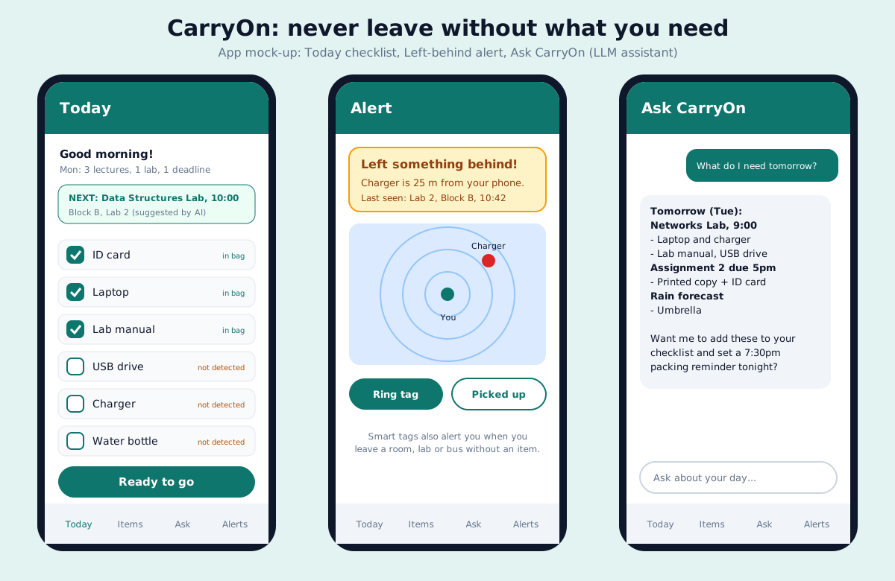
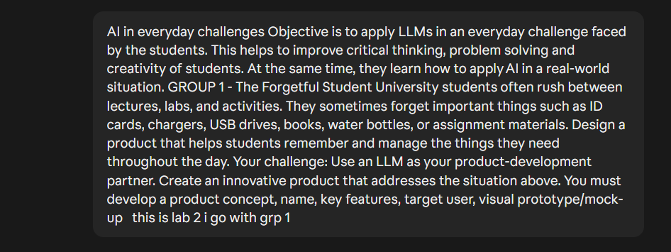
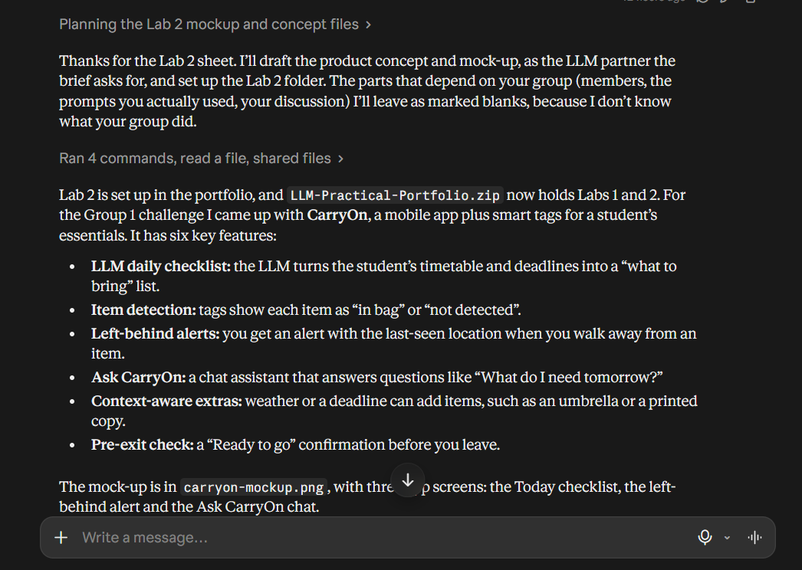

# Lab 02: LLMs in Everyday Life – The Forgetful Student

Module: PUSL 3205 – Large Language Models and Generative AI
Group: Group 1 – The Forgetful Student

## Laboratory Session
Lab 02 – AI in Everyday Challenges (group activity)

## Objective
Apply an LLM as a product-development partner to an everyday student problem, to build critical thinking, problem solving and creativity, and to practise applying AI in a real-world situation.

Challenge (Group 1): University students rush between lectures, labs and activities and forget items such as ID cards, chargers, USB drives, books, water bottles or assignment materials. Design a product that helps them remember and manage what they need through the day, with a concept, name, key features, target user and a visual prototype.

## Tasks and Implementation
1. Formed Group 1 and reviewed the challenge ([group members](group-activity/group-members.md)).
2. Used an LLM as a development partner to explore ideas, then to refine the concept, name and features ([discussion summary](group-activity/discussion-summary.md)).
3. Selected one concept, **CarryOn**, and defined its target user and key features ([activity outcomes](group-activity/activity-outcomes.md)).
4. Produced a visual mock-up of the app.

**Product summary:** CarryOn is a mobile app with smart tags for a student's essentials. An LLM turns the student's timetable and deadlines into a daily "what to bring" checklist, tags show what is in the bag, and alerts fire when something is left behind.

| Item | Detail |
|------|--------|
| Name | CarryOn |
| Target user | University students |
| Key features | LLM-generated daily checklist, tag-based item detection, left-behind alerts, "Ask CarryOn" assistant, context-aware extras, pre-exit check |

## Results and Evidence

Full write-up: [activity outcomes](group-activity/activity-outcomes.md). 

### LLM conversation (evidence of using the LLM as a development partner)

## Observations
The LLM's first response was a complete concept, with a name, target user, features and a mock-up, so it was quick to get started. However, we still had to check it against the brief and decide what to keep, because the LLM can produce plausible ideas without knowing whether students would actually use them. The mock-up is a static drawing, not a working app, and the risks it raised (privacy, tag cost and battery life) would need real research. 

## Learning Outcomes
- Practised using an LLM as a collaborator: prompting, evaluating its suggestions and iterating.
- Learned to turn a real student problem into a structured product concept (user, features, prototype).
- Saw practical LLM roles in a product: personalisation from schedule data, natural-language assistance and context-aware suggestions.
- Recognised limits and risks: privacy of timetable and location data, accuracy of suggestions, and the need for human review.
- Developed teamwork and communication skills through the group discussion.
