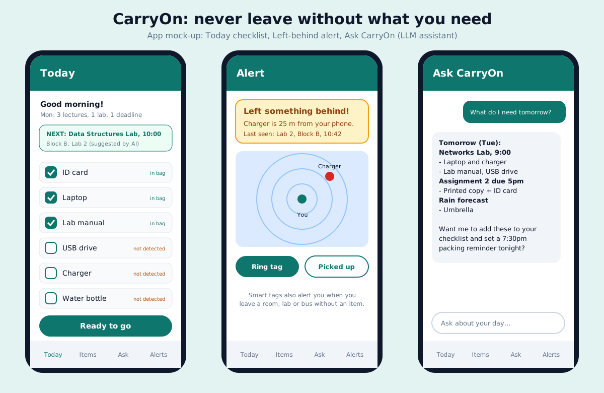

# Activity Outcomes – CarryOn

**Challenge:** Group 1 – The Forgetful Student. Design a product that helps students remember and manage the things they need throughout the day.

## Product name
**CarryOn**

## Tagline
*Never leave without what you need.*

## Target user
University students who move between lectures, labs and activities in one day and often forget essentials such as ID cards, chargers, USB drives, books, water bottles or assignment materials.

## Problem
Students' daily needs change with their timetable (a lab day needs different items from a lecture day). Existing reminders are generic, and nothing connects what a student must bring with where they are going next.

## Concept
CarryOn is a mobile app paired with low-cost smart tags (Bluetooth or NFC) attached to a student's essentials. The app knows the student's timetable and deadlines, uses an LLM to work out what is needed for each day, and checks whether those items are actually with the student.

## Key features
1. **Smart daily checklist:** the LLM reads the timetable and deadlines and builds a "what to bring" list (e.g. lab today → laptop, lab manual, USB drive; assignment due → printed copy).
2. **Tag-based item detection:** tagged items show as "in bag" or "not detected", so the student sees at a glance what is missing before leaving.
3. **Left-behind alerts:** the phone alerts the student when they walk away from a tagged item, and shows its last-seen location (e.g. "Charger, Lab 2, Block B, 10:42") with a "ring tag" button.
4. **Ask CarryOn (LLM assistant):** natural-language questions such as "What do I need tomorrow?", with an offer to add the answer to the checklist and set an evening packing reminder.
5. **Context-aware extras:** weather or schedule changes add items (umbrella if rain, a printed copy if a deadline is due).
6. **Pre-exit check:** a "Ready to go" confirmation near the door, or when the student leaves a room or lab.

## Visual prototype / mock-up
Three app screens: *Today* checklist, *Left-behind alert*, *Ask CarryOn*.

Editable source: [`../screenshots/carryon-mockup.svg`](../screenshots/carryon-mockup.svg)

## How the LLM is used in the product
- Turns a timetable and deadline list into a personalised daily packing list.
- Answers free-text questions about what to bring.
- Adapts the list to context (weather, room changes, new deadlines).

## Possible challenges and next steps
- Privacy of timetable and location data.
- Battery life and cost of tags.
- Accuracy of the LLM's suggestions; students must be able to edit the list.
- Next step: test with a small group of students and refine the checklist logic.
