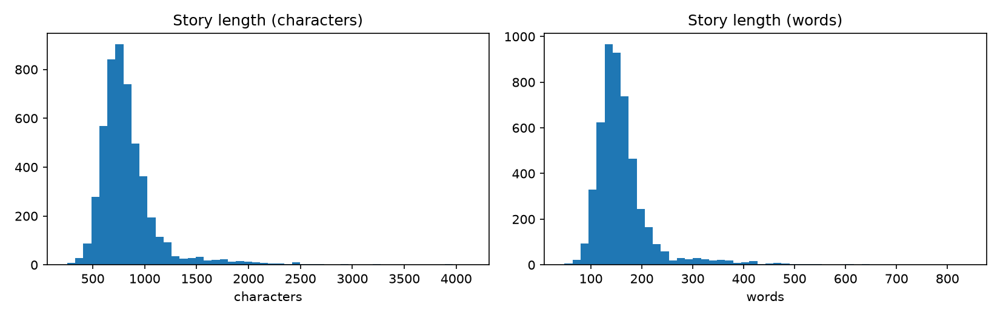
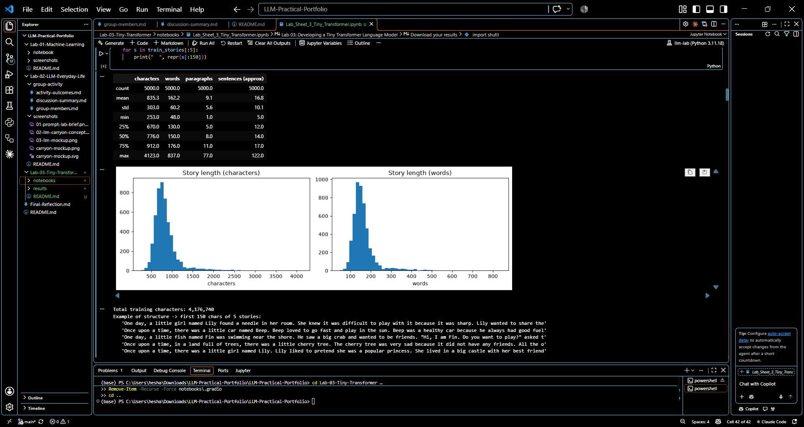
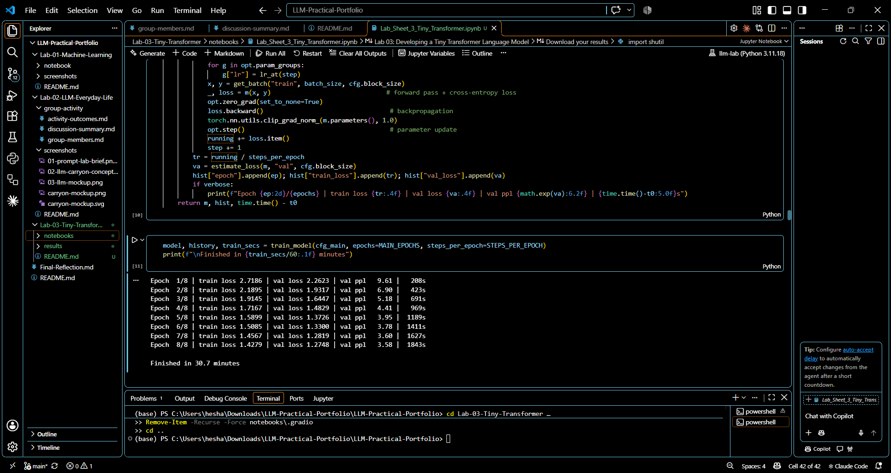
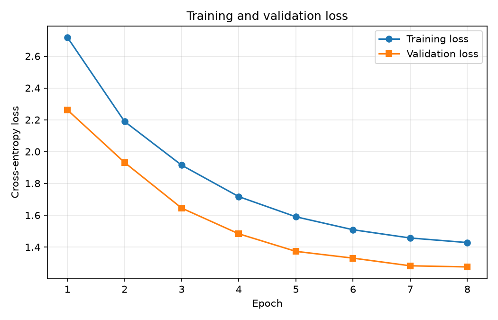
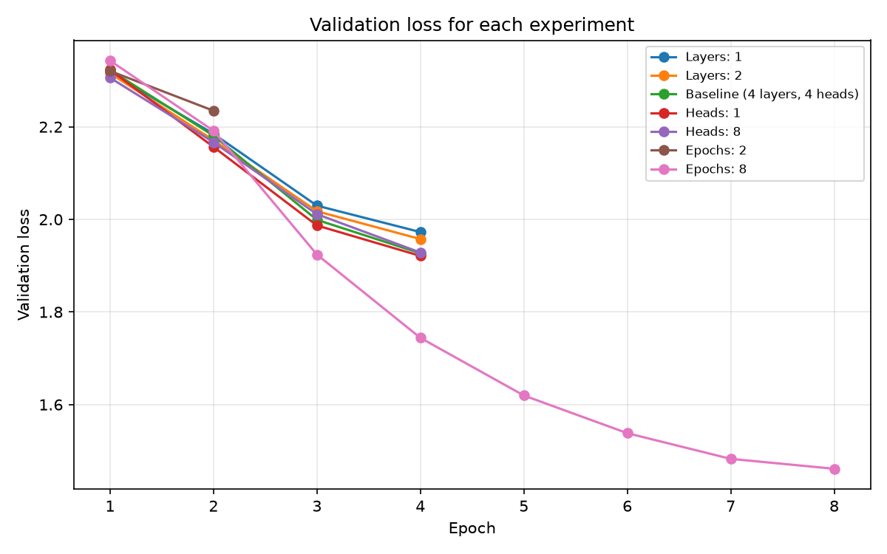
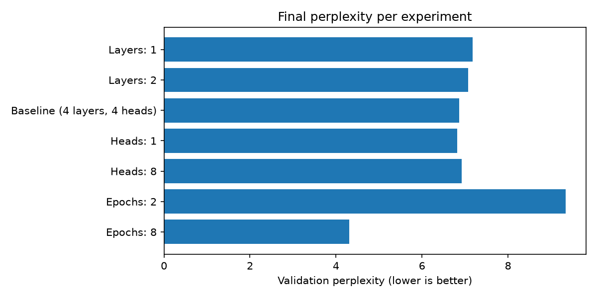
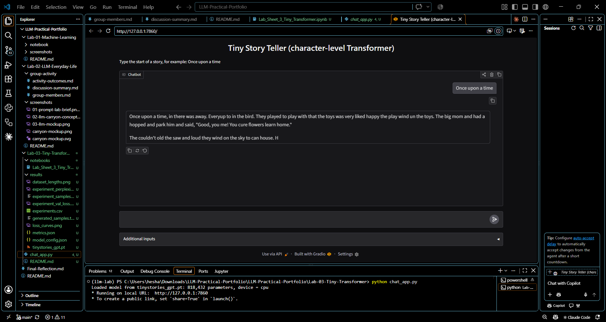

# Lab 03: Developing a Tiny Transformer Language Model

**Module:** PUSL 3205 – Large Language Models and Generative AI
**Notebook:** [`notebooks/Lab_Sheet_3_Tiny_Transformer.ipynb`](notebooks/Lab_Sheet_3_Tiny_Transformer.ipynb) (run in VS Code on CPU, outputs saved in the notebook)

## Laboratory Session
Lab 03 – Developing a Tiny Transformer Language Model

## Objective
Build a small GPT-style (decoder-only) Transformer from scratch in PyTorch, train it on a subset of the TinyStories dataset, evaluate it with loss and perplexity, generate stories, and study how the number of layers, attention heads and training epochs affect the results.

## Tasks and Implementation

| # | Task | What was done in the notebook |
|---|------|-------------------------------|
| 1 | Load the dataset | Loaded `roneneldan/TinyStories` from Hugging Face (streaming): 5,000 training and 500 validation stories. Displayed sample stories and plotted story-length statistics. |
| 2 | Preprocess | Character-level tokenizer built from the training stories (rare characters replaced by a space) plus an end-of-story token: vocabulary of 68 tokens. |
| 3 | Training data | Random windows of 128 characters; targets are the inputs shifted by one position (next-character prediction). |
| 4 | Transformer | Token and positional embeddings, masked multi-head self-attention, feed-forward layers, residual connections, layer normalization (pre-LN), weight tying. |
| 5 | Initialize | Baseline: 4 layers, 4 heads, embedding size 128, dropout 0.1 (818,432 parameters). Cross-entropy loss and AdamW optimizer. |
| 6 | Train | 8 epochs × 150 steps, batch size 64, learning-rate warm-up with cosine decay, gradient clipping. |
| 7 | Monitor | Recorded training and validation loss every epoch and plotted the curves. |
| 8 | Evaluate | Validation loss and perplexity (= exp(loss)). |
| 9 | Generate | Generated stories from three prompts and compared three temperatures. |
| 10 | Experiments | Varied layers (1, 2, 4), heads (1, 4, 8) and epochs (2, 4, 8) and compared loss, perplexity and generated text. |
| 11 | Save | Saved the weights, configuration and vocabulary (3.6 MB), reloaded the model and confirmed it gave identical outputs. |
| Optional | Chat window | Gradio chat interface that continues a story from the user's prompt. |

**Settings used.** There was no GPU on my computer, so the notebook ran on the CPU with reduced settings (the notebook's defaults are higher):

| Setting | Value used |
|---------|-----------|
| Device | CPU |
| Main model training | 8 epochs × 150 steps (1,200 steps), about 30.7 minutes |
| Experiments | 100 steps per epoch; 4 epochs for the layer and head runs; 2, 4 and 8 epochs for the epoch runs (about 61 minutes in total) |
| Random seed | 42 for every run |

Core model code (full version in the notebook):

```python
class Block(nn.Module):
    def forward(self, x):
        x = x + self.attn(self.ln1(x))   # masked multi-head self-attention + residual
        x = x + self.ffn(self.ln2(x))    # feed-forward + residual
        return x
```

## Results and Evidence

### Dataset
5,000 training stories, about 4.18 million characters. The average story is 835 characters (162 words), ranging from 253 to 4,123 characters.




### Training log and loss curves



| Epoch | Train loss | Val loss | Val perplexity |
|------:|-----------:|---------:|---------------:|
| 1 | 2.7186 | 2.2623 | 9.61 |
| 2 | 2.1895 | 1.9317 | 6.90 |
| 3 | 1.9145 | 1.6447 | 5.18 |
| 4 | 1.7167 | 1.4829 | 4.41 |
| 5 | 1.5899 | 1.3726 | 3.95 |
| 6 | 1.5085 | 1.3300 | 3.78 |
| 7 | 1.4567 | 1.2819 | 3.60 |
| 8 | 1.4279 | 1.2748 | 3.58 |

### Final metrics (main model)

| Metric | Value |
|--------|------:|
| Parameters | 818,432 |
| Initial loss (untrained) | 4.252 (random guessing = ln 68 = 4.220) |
| Training loss | 1.2996 |
| Validation loss | 1.2649 |
| Validation perplexity | **3.543** |
| Validation bits per character | 1.825 |
| Random-guess perplexity (= vocabulary size) | 68 |
| Training time | 30.7 minutes (CPU) |

### Generated stories
Prompt `"Once upon a time"`, temperature 0.8, top-k 40:

> Once upon a time, there was a little girl named Lily. He liked to his who the boy in take a what thought was and to he starts. He saw a gust friends and safed away. She car said so go her came it was very comple the day in the rach.

Effect of temperature on the same prompt (full text in `results/generated_samples.txt`):

| Temperature | Behaviour |
|-------------|-----------|
| 0.3 | Mostly real words but repetitive ("started to the ... started to ...") |
| 0.8 | A mix of real words and invented ones; sometimes ended early with the end-of-story token |
| 1.3 | Much more varied, but many garbled words and stray punctuation |

### Experiments (Task 10)

| Experiment | Layers | Heads | Epochs | Parameters | Val loss | Val perplexity | Time (s) |
|-----------|-------:|------:|-------:|-----------:|---------:|---------------:|---------:|
| Layers: 1 | 1 | 4 | 4 | 223,616 | 1.9706 | 7.175 | 155 |
| Layers: 2 | 2 | 4 | 4 | 421,888 | 1.9562 | 7.073 | 317 |
| Baseline (4 layers, 4 heads) | 4 | 4 | 4 | 818,432 | 1.9268 | 6.868 | 583 |
| Heads: 1 | 4 | 1 | 4 | 818,432 | 1.9196 | 6.819 | 363 |
| Heads: 8 | 4 | 8 | 4 | 818,432 | 1.9354 | 6.927 | 786 |
| Epochs: 2 | 4 | 4 | 2 | 818,432 | 2.2345 | 9.342 | 267 |
| Epochs: 8 | 4 | 4 | 8 | 818,432 | 1.4619 | 4.314 | 1189 |




Generated text from each experiment is in `results/experiment_samples.txt`.

### Gradio chat window
The Gradio app started at the local address `http://127.0.0.1:7860`. The public share link could not be created, so I used the local link.



## Observations

**Training.** The loss fell from 4.25 (random guessing) to about 1.26 and the perplexity from 68 to about 3.5, so the model learned a lot about the structure of the text. The curves flatten after epoch 6, which suggests more training would help only slowly. The training loss stays above the validation loss, which is not overfitting: the training loss is an average over the epoch with dropout switched on and while the weights are still improving, while the validation loss is measured at the end of the epoch with dropout off. The two curves stay close, so there was no sign of overfitting.

**Generated text.** The model learned the surface form of stories: capital letters, punctuation, quotation marks for dialogue, paragraph breaks, common names such as Lily and Anna, and the end-of-story token. It did not learn meaning. Many words are invented and the sentences are not coherent. This is expected for a character-level model with under 1 million parameters, a 128-character context, and only 1,200 training steps. Low temperature gave repetition and high temperature gave more garbled words.

**Experiments** (all single runs with one seed, so very small differences are not reliable):
- **Epochs had the biggest effect.** Going from 2 to 4 to 8 epochs lowered the validation loss from 2.2345 to 1.9268 to 1.4619 (perplexity 9.34 → 6.87 → 4.31). The generated text improved to match: the 2-epoch model produced mostly garbled letters, while the 8-epoch model produced more word-like text.
- **More layers helped a little.** Validation loss improved from 1.9706 (1 layer) to 1.9562 (2 layers) to 1.9268 (4 layers). The gains are small compared with the extra parameters (224k to 818k) and training time (155 s to 583 s).
- **Heads made little difference.** 1, 4 and 8 heads gave 1.9196, 1.9268 and 1.9354, a spread under 0.02 with identical parameter counts. The 1-head model was marginally best, so more heads did not help in this setup (with an embedding size of 128, 8 heads leaves only 16 dimensions per head). The 8-head run also took longer (786 s versus 363 s for 1 head).
- The experiments used fewer steps than the main run, so their losses (about 1.9) are higher than the main model's (1.26). They are comparable with each other, not with the main model.

**Challenges.**
- No NVIDIA GPU was available, so everything ran on the CPU and I reduced the number of epochs and steps. The experiments alone took about an hour.
- The vocabulary contains unusual characters (â, œ, ", €, ™) that come from encoding errors in some stories, and the model sometimes reproduces them (for example "’" in place of an apostrophe).
- The Gradio public share link could not be created, but the local link worked.

## Learning Outcomes
- Understood and implemented the components of a decoder-only Transformer: embeddings, masked multi-head self-attention, feed-forward layers, residual connections and layer normalization.
- Learned how next-token prediction training data is built and how cross-entropy loss, backpropagation and AdamW train a language model.
- Learned to read loss curves, compute perplexity, and tell the difference between a normal train/validation gap and overfitting.
- Saw how temperature changes generated text, and how a small character-level model learns form before meaning.
- Ran controlled experiments and learned that, in this setup, training length mattered far more than the number of layers or heads, and that single-run differences must be treated with caution.
- Learned to save and reload a model with its configuration and vocabulary.

## Mechanisms that improve performance
- **Self-attention** lets each character use information from all earlier characters in the window; **multi-head attention** lets different heads look for different patterns.
- **Causal masking** stops the model seeing future characters, so training matches text generation.
- **Positional embeddings** give word-order information, which attention alone ignores.
- **Residual connections** and **layer normalization** keep gradients stable so deeper models can be trained.
- **Weight tying** shares the embedding and output matrices, reducing parameters.
- **AdamW**, a **learning-rate warm-up and cosine schedule**, and **gradient clipping** make training stable, and **dropout** helps against overfitting.
- **Temperature and top-k sampling** control the quality and variety of generated text.
