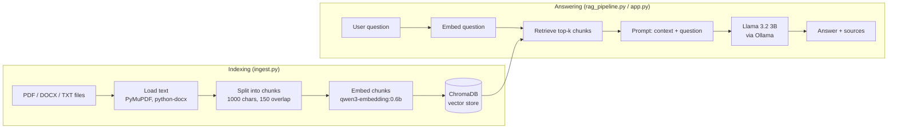
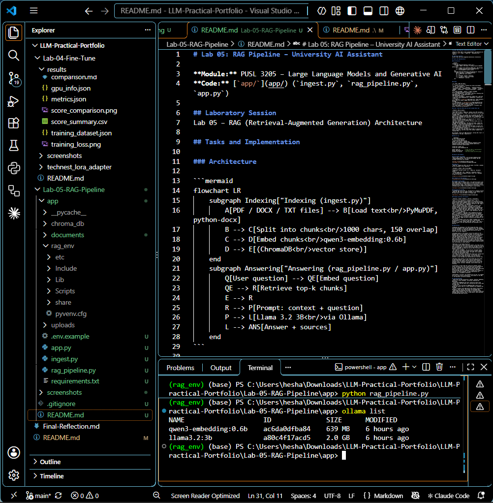
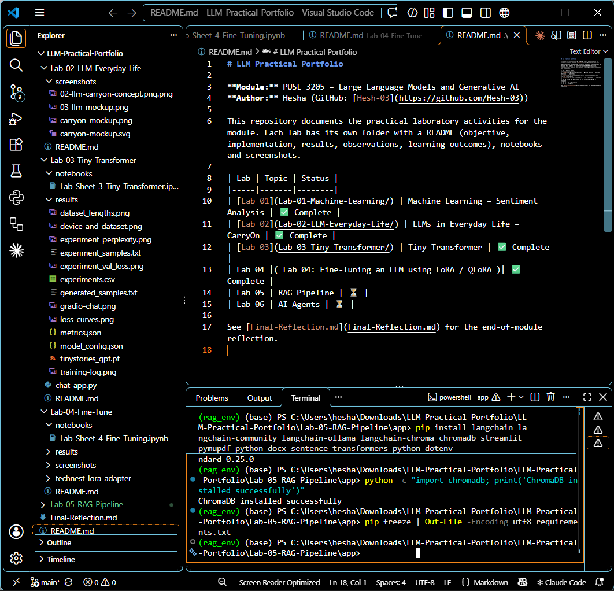
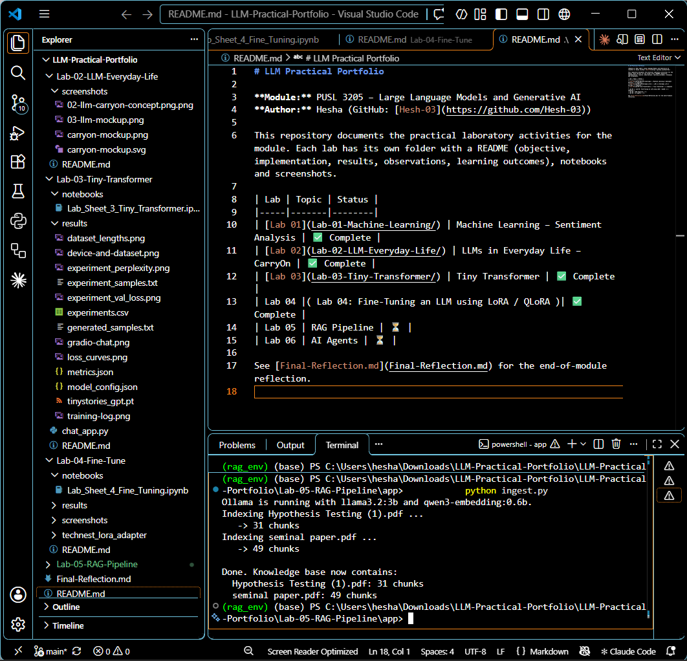
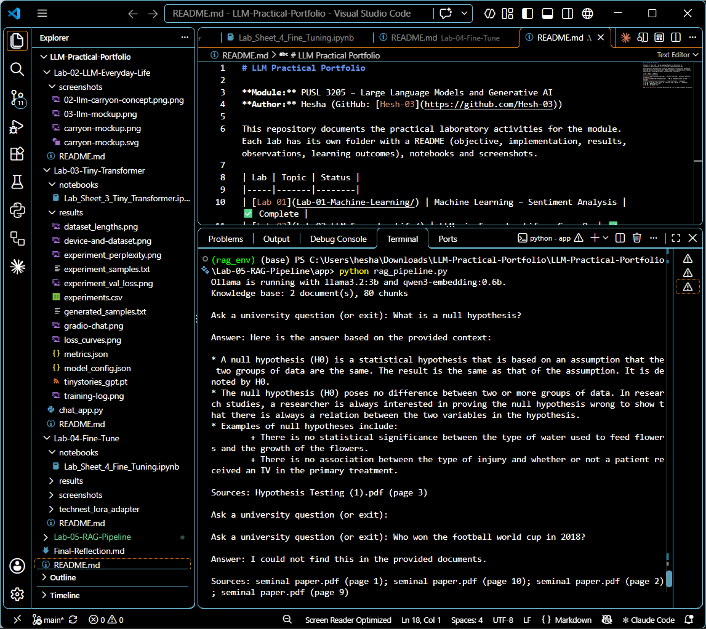
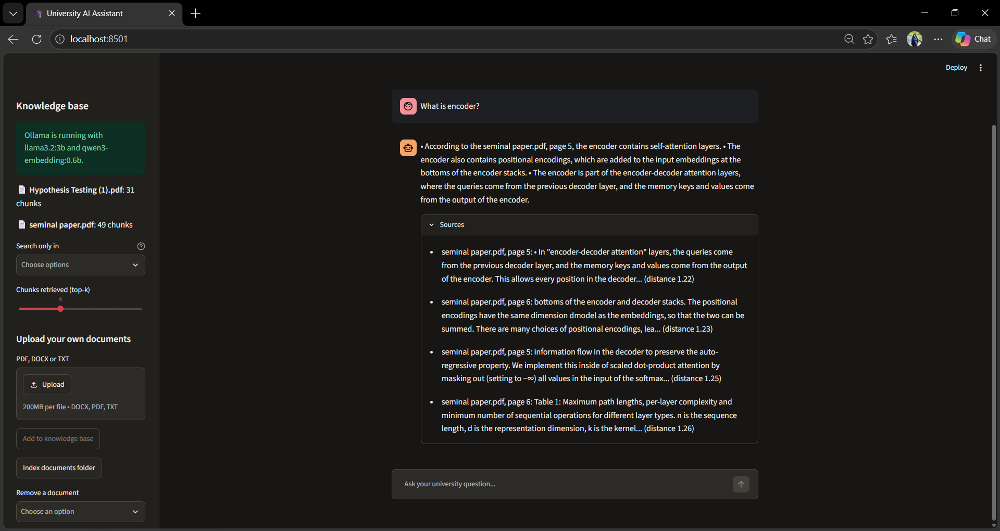
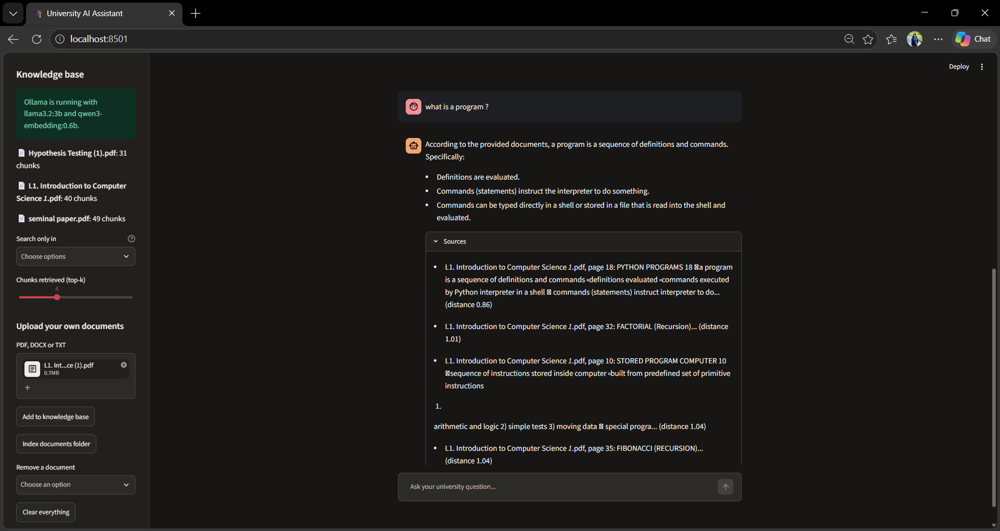

# Lab 05: RAG Pipeline – University AI Assistant

**Module:** PUSL 3205 – Large Language Models and Generative AI
**Code:** [`app/`](app/) (`ingest.py`, `rag_pipeline.py`, `app.py`)

## Laboratory Session
Lab 05 – RAG (Retrieval-Augmented Generation) Architecture

## Tasks and Implementation

### Architecture



### Steps 

| # | Step | What was done |
|---|------|---------------|
| 1 | Python environment | Created the virtual environment `rag_env` with Python 3.12. |
| 2 | Install libraries | `langchain`, `langchain-community`, `langchain-ollama`, `langchain-chroma`, `chromadb`, `streamlit`, `pymupdf`, `python-docx`, `sentence-transformers`, `python-dotenv`. |
| 3 | Check ChromaDB | `python -c "import chromadb; print('ChromaDB installed successfully')"`. |
| 4 | Save dependencies | `pip freeze | Out-File -Encoding utf8 requirements.txt` ([`app/requirements.txt`](app/requirements.txt)). |
| 5 | Install the models | `ollama pull llama3.2:3b` (LLM) and `ollama pull qwen3-embedding:0.6b` (embeddings); checked with `ollama list`. |
| 6 | Ingestion | [`ingest.py`](app/ingest.py): loads documents, splits them into chunks, embeds them and stores them in ChromaDB. |
| 7 | RAG pipeline | [`rag_pipeline.py`](app/rag_pipeline.py): retrieves the most similar chunks, builds the prompt and asks Llama 3.2 for an answer (command-line chat). |
| 8 | Chat window | [`app.py`](app/app.py): a Streamlit chat window ("University AI Assistant"). |

### Task: read more PDFs and let users upload their own

| Feature | How it works |
|---------|--------------|
| Many PDFs at once | `ingest.py` indexes every PDF (and DOCX / TXT) in the `documents/` folder. Each chunk stores its file name and page number. |
| Upload in the app | The sidebar has an uploader for PDF, DOCX and TXT files. Uploaded files are read, split, embedded and added to the knowledge base immediately, so questions about them work straight away. |
| Search only some documents | A "Search only in" selector restricts retrieval to the chosen files. |
| Sources | Every answer lists the retrieved chunks with file name, page and distance. |
| Manage the knowledge base | Re-index the folder, remove one document, or clear everything. Re-indexing a file replaces its old chunks, so there are no duplicates. |
| Grounded answers | The prompt tells the model to answer only from the retrieved context and to say "I could not find this in the provided documents" otherwise. |
| Error handling | The app checks that Ollama is running and the models are pulled, and warns about PDFs without readable text (scanned PDFs). |

Key settings: chunk size 1000 characters, overlap 150, top-k = 4 (adjustable in the app), temperature 0.

### How to run

```powershell
cd Lab-05-RAG-Pipeline\app
py -3.12 -m venv rag_env
.\rag_env\Scripts\Activate.ps1
python -m pip install --upgrade pip
pip install langchain langchain-community langchain-ollama langchain-chroma chromadb streamlit pymupdf python-docx sentence-transformers python-dotenv

ollama pull llama3.2:3b
ollama pull qwen3-embedding:0.6b

python ingest.py          # index the PDFs in app/documents/
python rag_pipeline.py    # command-line chat
streamlit run app.py      # web chat window with PDF upload
```

## Results and Evidence

### Environment and models
Llama 3.2 3B (`llama3.2:3b`) and the Qwen3 embedding model (`qwen3-embedding:0.6b`) were pulled with Ollama, and the ChromaDB installation was checked.




### Ingestion
`ingest.py` indexed two PDFs into 80 chunks. The PDFs I indexed are not included in this repository.

| Document | Chunks | How it was added |
|----------|-------:|------------------|
| Hypothesis Testing (1).pdf | 31 | `ingest.py` (documents folder) |
| seminal paper.pdf | 49 | `ingest.py` (documents folder) |
| L1. Introduction to Computer Science 1.pdf | 40 | uploaded through the web app |



### Command-line RAG pipeline


### Streamlit chat window
The sidebar shows the Ollama status, the indexed documents with their chunk counts, a "Search only in" filter, the top-k slider and the upload controls. Each answer has a **Sources** section showing the file, page, a text snippet and the distance of every retrieved chunk (a smaller distance means a closer match).



### Uploading my own PDF
I uploaded the lecture PDF *L1. Introduction to Computer Science 1.pdf* (0.7 MB) with the sidebar uploader. It was indexed into 40 chunks and I could ask about it straight away.



### Example questions and answers

| Question | Answer (summary) | Sources | Assessment |
|----------|------------------|---------|------------|
| What is a null hypothesis? *(command line)* | H0 is a statistical hypothesis assuming there is no difference between groups of data; gives examples (type of water and flower growth, type of injury and an IV). | Hypothesis Testing (1).pdf, page 3 | Correct and grounded in the document. |
| What is encoder? *(web app)* | The encoder contains self-attention layers and positional encodings, and its output provides the keys and values for the decoder's encoder-decoder attention. | seminal paper.pdf, pages 5 and 6 (distance 1.22–1.26) | Partly good: the facts come from the paper, but it is a list of related facts rather than a clear definition, and the last sentence is imprecise. |
| what is a program ? *(web app, after uploading the lecture PDF)* | A program is a sequence of definitions and commands; definitions are evaluated and commands instruct the interpreter to do something. | L1. Introduction to Computer Science 1.pdf, pages 18, 32, 10 and 35 (distance 0.86–1.04) | Correct. Page 18 holds the answer; pages 32 and 35 (factorial and Fibonacci) are not relevant. |
| Who won the football world cup in 2018? *(command line, not in the documents)* | "I could not find this in the provided documents." | Listed: seminal paper.pdf, pages 1, 10, 2 and 9 | Correct refusal, but the listed sources are unrelated to the question. |

## Observations

**Indexing and uploading.** Two PDFs became 80 chunks, and a third PDF uploaded in the web app became 40 more. The uploaded file was available for questions immediately, without restarting anything. [TO FILL: how long indexing took and how long an answer took on your computer.]

**Grounded answers.** The answers follow the content of the documents and cite the document and page, so each answer can be checked. When I asked a question that is not in the documents (the 2018 football World Cup), the model gave the refusal sentence required by the prompt instead of inventing an answer. This is a clear difference from Lab 4, where the fine-tuned model confidently made up prices for facts it had never seen. Putting the retrieved text into the prompt and telling the model to use only that text worked much better against made-up answers than fine-tuning on a small dataset.

**Retrieval is not always precise.**
- The search always returns the top-4 chunks, even when none of them is relevant. For the refused question, the app still listed four unrelated pages as sources, which could mislead a reader. A distance threshold, or hiding the sources when the answer is a refusal, would fix this.
- For "what is a program?", two of the four retrieved chunks (the factorial and Fibonacci slides) were not useful, because the fixed top-k keeps weak matches. The model still answered correctly from the relevant chunk.
- For "What is encoder?", the retrieved chunks were relevant but none of them was a direct definition, so the answer was a collection of facts about the encoder, with one imprecise sentence. A small 3B model has limited ability to correct this.

**Document layout matters.** The lecture PDF came from slides, so each page became a short chunk, and the extracted text contains stray box symbols from the bullet icons. Fixed-size chunking works on characters and ignores the structure of the document (slides, sections, headings), which affects what is retrieved.

**Limitations.** Basic RAG uses fixed-size chunking, dense-vector retrieval only, and a fixed top-k with no reranking and no check of whether the retrieved text really answers the question. These are exactly the weaknesses that the advanced RAG group activity (hybrid retrieval, hierarchical chunking, corrective RAG and so on) addresses. I tested only a handful of questions on three documents, so these observations are examples, not a systematic evaluation.

**Challenges.** [TO FILL: any problems you ran into, for example the size of the library installation, slow answers on the CPU, or the PowerShell activation message.]

## Learning Outcomes
- Understood the RAG architecture: loading, chunking, embedding, storing in a vector database, retrieving, prompting and generating.
- Learned how embeddings and vector similarity search find relevant text, and how chunk size, overlap and top-k affect what the model sees.
- Learned to run an LLM and an embedding model locally with Ollama and connect them to a vector database with LangChain and ChromaDB.
- Built a Streamlit chat application that answers from several documents, shows sources, and accepts user-uploaded PDFs.
- Understood why grounding the prompt in retrieved context reduces made-up answers, and the limits of basic RAG (fixed-size chunking, dense retrieval only, a fixed top-k), which motivates the advanced RAG group activity.
